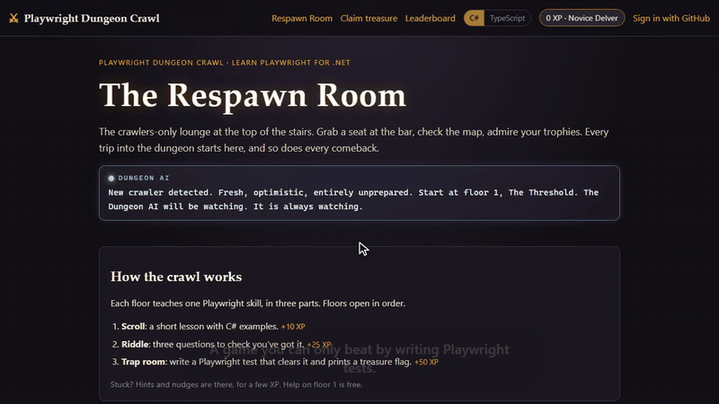

# Josh Giller | Senior Quality Engineer, SDET & Test Automation Engineer

I help teams build confidence in software by testing behavior across unit, API, UI, real mobile devices, performance, and visual quality. This portfolio demonstrates hands-on quality analysis and automation engineering across C#, TypeScript, and Kotlin, with CI pipelines and reporting that make results actionable.

💼 Previously **Staff Quality Analyst at FanDuel**: primary lead tester for the new Picks and Predicts apps on iOS and Android, mobile test automation with TypeScript, Appium, Playwright and BrowserStack, and testing for the DFS website and Sportsbook apps.

📄 [LinkedIn](https://www.linkedin.com/in/josh-giller/)

📊 [Live test dashboard](https://azureteal56.grafana.net/public-dashboards/75e468f01dbe46d39825dd87a9c6d1a6): pass rates, failures, flaky tests and load-test results from every repo below, updated on each CI run

🎮 **Want to learn Playwright?** Play the [Playwright Dungeon Crawl](https://playwright-dungeon-crawl.onrender.com), a free, hands-on game I built: write real Playwright tests, in **C# or TypeScript**, to clear trap rooms floor by floor. All nineteen floors, from locators and auto-waiting to tabs, file uploads, two users signed in at once, API testing, mocked responses, the Page Object Model, parallel tests, visual comparison, device and clock emulation, with bosses on floors 7 and 13 and a final boss that is a flaky test. Sign in with GitHub to save your progress, climb the leaderboard, earn verifiable certificates you can add to LinkedIn (up to Ultimate Dungeoneer for clearing every floor), spend XP on titles and torches in the loot shop, replay cleared rooms as Cursed Runs, and join the Hall of Bugslayers by reporting a real bug in the game. *It's on a free host, so the first visit can take a minute to wake up.*

Recorded with [Showrunner](https://github.com/gillersja1/Showrunner), my tool that turns a scripted Playwright flow into a demo video.

## Where to start

Short on time? These four show the most:

- **[PlaywrightTestingShowcase](https://github.com/gillersja1/PlaywrightTestingShowcase)**: the broadest single repo. Unit, API and UI tests in one solution, cross-browser CI, Allure reports, and mutation testing.
- **[DevtestLike](https://github.com/gillersja1/DevtestLike)**: enterprise integration testing. SOAP/XML workflows, OAuth2 + WS-Security, database validations, messaging and a virtualized third-party service, all started by `dotnet test`.
- **[Playwright Dungeon Crawl](https://playwright-dungeon-crawl.onrender.com)**: a live product I built, ship and test: 19 floors, 170+ server tests and 90+ reference solutions (C# and TypeScript) run against its Docker image on every change, plus an OWASP ZAP security scan and a test timeline on every PR, and Stryker.NET mutation testing every week.
- **[Live test dashboard](https://azureteal56.grafana.net/public-dashboards/75e468f01dbe46d39825dd87a9c6d1a6)**: every repo's CI results in one Grafana view (pass rates, failures, flaky tests).

From there, [ApplitoolsPlaywrightCSharp](https://github.com/gillersja1/ApplitoolsPlaywrightCSharp) and [BrowserStackMobileTests](https://github.com/gillersja1/BrowserStackMobileTests) each add a specialized capability on the same Playwright/C#/NUnit foundation, and [JMeterLoadTestExample](https://github.com/gillersja1/JMeterLoadTestExample) / [K6LoadTestExample](https://github.com/gillersja1/K6LoadTestExample) show the same load test built in a GUI tool and written as code.

## Skills at a glance

| Skill | Where to see it |
|---|---|
| UI automation (Playwright, Selenium) | [PlaywrightTestingShowcase](https://github.com/gillersja1/PlaywrightTestingShowcase), [PlaywrightTsUiTests](https://github.com/gillersja1/PlaywrightTsUiTests), [SeleniumCSharpUiTests](https://github.com/gillersja1/SeleniumCSharpUiTests) |
| API testing | [PlaywrightTestingShowcase](https://github.com/gillersja1/PlaywrightTestingShowcase) (Playwright API), [PostmanReports](https://github.com/gillersja1/PostmanReports) (Postman/Newman) |
| Contract testing | [PactContractTestingExample](https://github.com/gillersja1/PactContractTestingExample) (Pact, consumer-driven) |
| Service virtualization & enterprise integration | [DevtestLike](https://github.com/gillersja1/DevtestLike): DevTest-style SOAP/XML orchestration, OAuth2 + WS-Security, database validations, virtual services (WireMock.Net) |
| Mutation testing | [PlaywrightTestingShowcase](https://github.com/gillersja1/PlaywrightTestingShowcase) (Stryker.NET, with the mutant it caught and the fix) |
| Real-device mobile testing | [BrowserStackMobileTests](https://github.com/gillersja1/BrowserStackMobileTests) |
| Native Android app & tests | [CollectorsTrackingApp](https://github.com/gillersja1/CollectorsTrackingApp) (unit, emulator UI tests, Firebase security-rules tests) |
| Visual regression | [ApplitoolsPlaywrightCSharp](https://github.com/gillersja1/ApplitoolsPlaywrightCSharp) |
| Accessibility | [PlaywrightTestingShowcase](https://github.com/gillersja1/PlaywrightTestingShowcase) |
| Test strategy | [PlaywrightTestingShowcase/docs/TEST_STRATEGY.md](https://github.com/gillersja1/PlaywrightTestingShowcase/blob/main/docs/TEST_STRATEGY.md): risk-based coverage, flaky-test policy, defect triage |
| Performance / load | [JMeterLoadTestExample](https://github.com/gillersja1/JMeterLoadTestExample), [K6LoadTestExample](https://github.com/gillersja1/K6LoadTestExample) |
| CI/CD & reporting | GitHub Actions in every repo; Allure, Playwright HTML, JMeter dashboards |
| Observability | Every repo's CI test results sent to one Grafana Cloud dashboard over OpenTelemetry ([test-results-otel](https://github.com/gillersja1/test-results-otel), [live dashboard](https://azureteal56.grafana.net/public-dashboards/75e468f01dbe46d39825dd87a9c6d1a6)) |
| Secret hygiene | gitleaks secret scanning in CI ([BrowserStackMobileTests](https://github.com/gillersja1/BrowserStackMobileTests)) |
| Exploratory & security testing | [Gremlin](https://github.com/gillersja1/Gremlin): a seeded explorer that finds crashes, HTML injection, leaked errors and missing security headers, with a Playwright repro test for each |
| Test tooling | [Gremlin](https://github.com/gillersja1/Gremlin), [Showrunner](https://github.com/gillersja1/Showrunner) (demo videos from Playwright scripts), [test-results-otel](https://github.com/gillersja1/test-results-otel) |
| Teaching | [Playwright Dungeon Crawl](https://playwright-dungeon-crawl.onrender.com) and its starter kits ([C#](https://github.com/gillersja1/PlaywrightDungeonCrawl-Starter), [TypeScript](https://github.com/gillersja1/PlaywrightDungeonCrawl-Starter-TS)) |

## Projects

| Project | Stack | What it demonstrates | CI |
|---|---|---|---|
| [PlaywrightTestingShowcase](https://github.com/gillersja1/PlaywrightTestingShowcase) | C#, NUnit, Playwright | Unit, API, and UI tests in one solution; Page Object Model; Allure reporting merged across all three layers; cross-browser CI matrix (Chromium/Firefox/WebKit) |  |
| [PlaywrightTsUiTests](https://github.com/gillersja1/PlaywrightTsUiTests) | TypeScript, Playwright Test | Idiomatic Playwright Test + Page Object Model; cross-browser and mobile-viewport emulation via declarative config; CI with HTML report artifacts |  |
| [BrowserStackMobileTests](https://github.com/gillersja1/BrowserStackMobileTests) | C#, NUnit, Playwright, BrowserStack | UI tests running on **real mobile devices** (not emulators) via BrowserStack Automate; credentials kept in CI secrets with a gitleaks scan on every push |  |
| [ApplitoolsPlaywrightCSharp](https://github.com/gillersja1/ApplitoolsPlaywrightCSharp) | C#, NUnit, Playwright, Applitools Eyes | AI-powered visual regression testing; Ultrafast Grid rendering across multiple browsers/devices from a single local page load |  |
| [SeleniumCSharpUiTests](https://github.com/gillersja1/SeleniumCSharpUiTests) | C#, NUnit, Selenium WebDriver | The same kind of UI suite built with Selenium, for direct comparison against the Playwright C# suite; Selenium Manager handles driver binaries automatically |  |
| [JMeterLoadTestExample](https://github.com/gillersja1/JMeterLoadTestExample) | Apache JMeter, Node.js | Parameterized load test plan against a local reqres-compatible mock API; CI fails the build on latency or error-rate thresholds; HTML dashboard reporting |  |
| [K6LoadTestExample](https://github.com/gillersja1/K6LoadTestExample) | Grafana k6, JavaScript | The same load test written as code: ramping scenario, per-endpoint checks, and thresholds (with early abort) defined in the script; HTML dashboard and job-summary report in CI |  |
| [PostmanReports](https://github.com/gillersja1/PostmanReports) | Postman, Newman, GitHub Actions | API test collection (37 requests, 53 assertions) run with Newman in CI; real API defects tracked in a non-blocking Known Defects folder; HTML and JUnit reports |  |
| [PactContractTestingExample](https://github.com/gillersja1/PactContractTestingExample) | C#, NUnit, PactNet, ASP.NET Core | Consumer-driven contract tests: the consumer generates a pact against a mock server, the provider verifies the real API against it in CI; includes tests proving a renamed field breaks the contract and an added field does not |  |
| [DevtestLike](https://github.com/gillersja1/DevtestLike) | C#, NUnit, WireMock.Net, Keycloak, Postgres, Testcontainers | Enterprise test automation in the style of Broadcom DevTest: a legacy SOAP/XML service tested through multi-step workflows (XPath between steps, every reply validated against an XSD), two auth layers (OAuth2 from a real Keycloak plus WS-Security), database validations against a real Postgres, a virtualized third-party dependency (outages, timeouts, stateful restarts), and CSV data sets; everything starts with `dotnet test` |  |
| [NeverDeliverShopTests](https://github.com/gillersja1/NeverDeliverShopTests) | TypeScript, Playwright Test | Purchase-flow tests against a satirical "never deliver" e-commerce demo site, using role- and text-based locators |  |
| [test-results-otel](https://github.com/gillersja1/test-results-otel) | Python, GitHub Actions, OpenTelemetry, Grafana | A reusable GitHub Action that turns TRX, JUnit, k6 and JMeter results into OpenTelemetry logs and metrics; every repo here sends its CI results to one Grafana dashboard (pass rate, failures with run links, flaky and slowest tests, known defects, load-test checks) |  |
| [Gremlin](https://github.com/gillersja1/Gremlin) | TypeScript, Playwright | Exploratory "monkey" testing with guardrails: it clicks, types awkward input and follows links on your own site, then reports server errors, input that comes back as HTML, leaked stack traces, broken links, insecure cookies and missing security headers, each with screenshots, a trace and a ready-to-run Playwright test. Its first run found the missing headers on my dungeon; they're fixed and a re-run comes back clean |  |
| [Showrunner](https://github.com/gillersja1/Showrunner) | TypeScript, Playwright, ffmpeg | Turns a scripted Playwright flow into a polished demo video: a drawn cursor, captions, click ripples and auto-zoom on clicks, re-recorded with one command when the UI changes |  |
| [Dungeon starter kit (C#)](https://github.com/gillersja1/PlaywrightDungeonCrawl-Starter) / [(TypeScript)](https://github.com/gillersja1/PlaywrightDungeonCrawl-Starter-TS) | C#, NUnit / TypeScript, Playwright Test | The projects players clone for the [Playwright Dungeon Crawl](https://playwright-dungeon-crawl.onrender.com); a daily workflow runs the example test against the live game to catch breakage |  |
| [CollectorsTrackingApp](https://github.com/gillersja1/CollectorsTrackingApp) | Kotlin, Android, Room, Firebase | An Android app I built and test myself: offline-first sync tested with two simulated phones, Room migration tests, Espresso UI tests on an Android emulator against the Firebase emulators, and Firestore security-rules tests, all in CI |  |

## Quality engineering focus

These projects show how I approach quality from multiple angles:

- **Analyze behavior at multiple layers** — unit, API, contract, and end-to-end checks help pinpoint where a defect occurs
- **Test integrated enterprise systems** — orchestrated XML workflows across services, authentication and database validations, with unavailable dependencies virtualized
- **Test the tests** — mutation testing shows whether a suite would actually catch a bug
- **Assess platform and device coverage** — desktop browsers, real mobile devices, and mobile viewport emulation
- **Evaluate non-functional quality** — load testing with pass/fail thresholds in two tools (JMeter and k6), plus accessibility checks
- **Catch visual regressions** — AI-based visual comparison complements functional assertions
- **Explore like a user, and like an attacker** — scripted checks cover what you expect; Gremlin goes looking for what you didn't, without exploiting anything it finds
- **Make feedback useful** — CI workflows and test reports help teams review outcomes and investigate failures, and one dashboard tracks pass rates, flaky tests and known defects across every repo

They also intentionally span **three languages** (C#, TypeScript, and
Kotlin) and **two browser automation tools** (Playwright and Selenium
WebDriver), to show range rather than depth in only one stack.

## A shared test target

Most of the web UI suites point at [saucedemo.com](https://www.saucedemo.com/) —
a public demo store built specifically for test automation practice — so
the same application is exercised across several projects. That makes it
easy to compare *how* each tool/framework approaches the same problem
(e.g., the Playwright C# UI suite vs. the Playwright TypeScript UI suite vs.
the Selenium suite, testing the same login flow).
